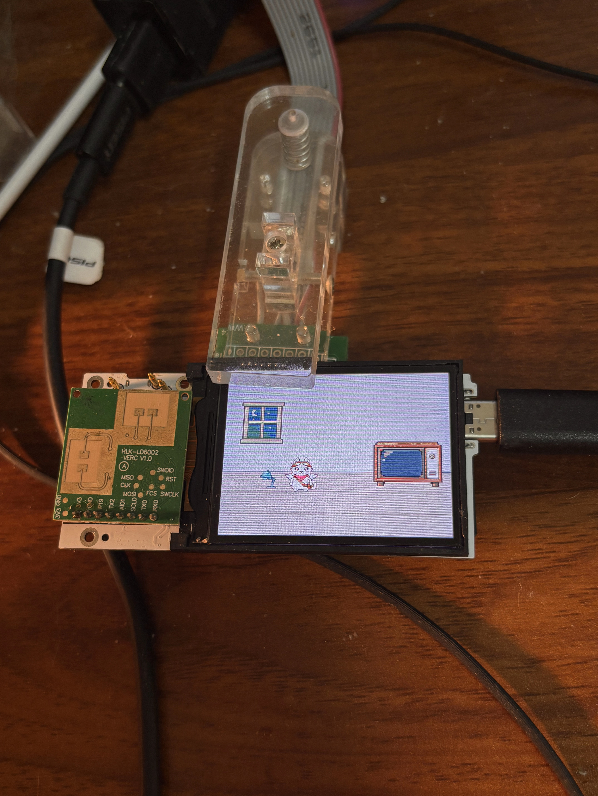

# EP Native Pixel Game: Art and mmWave Interaction Progress

I'm currently developing EP's native pixel game, and most of the art assets are now complete. The next step is to bring the artwork and gameplay together, turning the characters and scenes into a playable experience.

I've also validated the mmWave radar interaction. It works, but detection errors still happen occasionally. When a player makes a movement and the game doesn't respond as expected, that can interrupt the experience and cause confusion or frustration.

I'm planning to explore game design choices that reduce the impact of those occasional errors. The details still need testing, but I want to build some tolerance into the interaction so players can keep playing comfortably even when the radar gets something wrong.

Next, I'll continue developing the native pixel game and use playtesting feedback to refine both the radar interaction and the game's responses.
